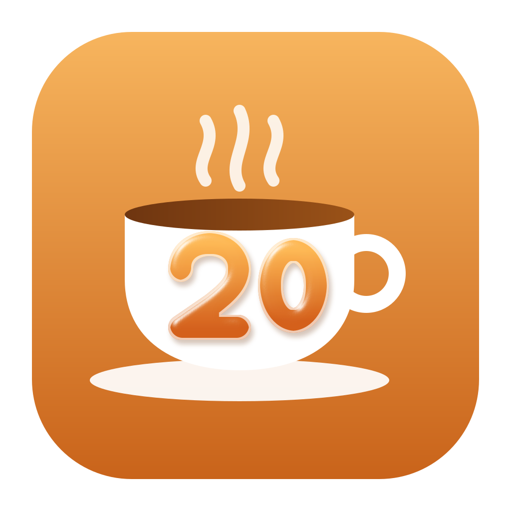

<p align="center"></p>

# Twentea

A free, open source eye-break app for macOS and Windows. Every 20 minutes it asks you to look 20 feet away for 20 seconds, and it can dim the screen or cover it until you do.

- One big power button turns everything on or off.
- Six presets (Gentle, Balanced, Strict, Night owl, Meeting heavy, Minimal), plus your own saved presets.
- Breaks can show as a menu bar countdown, notification, floating card, soft dim, full overlay or hard lock. Each one can be switched off.
- Waits for a natural pause before a break, counts time away as a break, and pauses during calls and video.
- Working hours per weekday, including sessions that run past midnight.
- Everything stays on your Mac.

## Download

Grab the latest build from [Releases](../../releases): `Twentea-<version>.dmg` for macOS 14 or later,
`Twentea-<version>-win-x64.zip` or `-win-arm64.zip` for Windows 10 and 11.

## Build

macOS needs the Swift command line tools. Xcode is not required.

```bash
cd mac
scripts/test.sh
scripts/bundle.sh
open build/Twentea.app
```

Windows needs the .NET 10 SDK.

```powershell
cd windows
dotnet test Twentea.slnx
dotnet run --project src/Twentea.Windows
```

## Automation

On Windows, use the same URLs with `start twentea://toggle`.

```bash
open "twentea://toggle"
open "twentea://break"
open "twentea://pause?minutes=30"
open "twentea://preset?id=night-owl"
```

See [docs/TECHNICAL.md](docs/TECHNICAL.md) for the design, [docs/WINDOWS.md](docs/WINDOWS.md) for the Windows plan and [CONTRIBUTING.md](CONTRIBUTING.md) before sending a change.

## License

MIT
