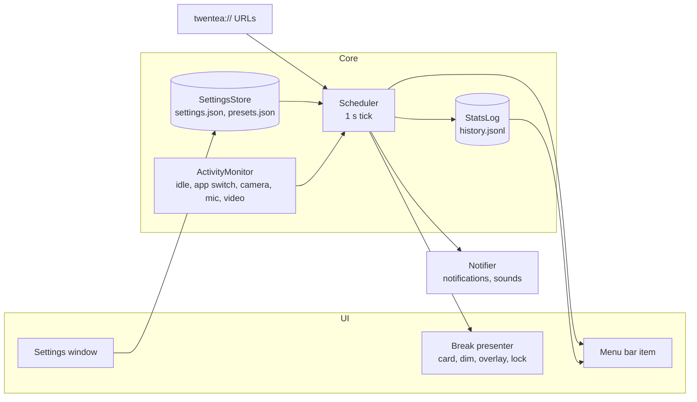
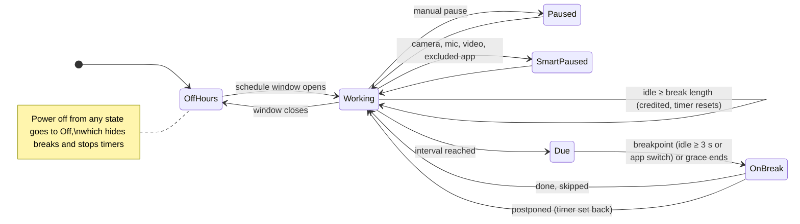
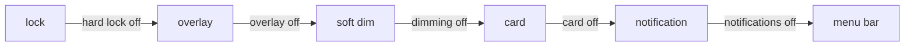
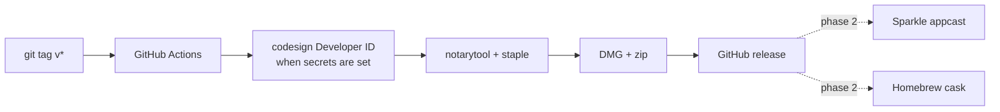

# Twentea technical design

Twentea's Mac app is a native macOS menu bar app that schedules eye breaks, enforces them with dimming or overlays, and (later) winds displays down in the evening. Free, MIT, distributed as a notarized DMG and a Homebrew cask.

## Stack

| Layer | Choice |
|---|---|
| Language | Swift 6 toolchain, Swift 5 language mode |
| UI | SwiftUI (`MenuBarExtra`, settings window) + AppKit (`NSPanel` overlays) |
| Build | Swift Package Manager in `mac/`; `mac/scripts/bundle.sh` wraps the binary into `Twentea.app` |
| Storage | JSON in `~/Library/Application Support/Twentea/` |
| Login item | `SMAppService.mainApp` |
| Updates | Sparkle 2 (phase 2) |
| Minimum OS | macOS 14 |

No Xcode project. Everything builds with `swift build` and the command line tools.

## Architecture



| Module | File | Job |
|---|---|---|
| Model | `Model/Settings.swift` | `AppSettings`, `BreakConfig`, `WeekSchedule`, `Features`, `Enforcement` |
| Presets | `Model/Presets.swift` | Six built-in presets |
| Store | `Model/SettingsStore.swift` | Load, save, active preset, Custom detection, user presets, import, export |
| Scheduler | `Core/Scheduler.swift` | Break state machine, timers, postpone, skip, credit |
| Activity | `Core/ActivityMonitor.swift` | Idle seconds, last app switch, frontmost app, camera/mic/video in use |
| Stats | `Core/StatsLog.swift` | Append events, today's counts |
| Presenter | `Present/BreakPresenter.swift` | Floating card, soft dim, overlay, lock windows on every screen |
| Notifier | `Present/Notifier.swift` | `UNUserNotificationCenter` and `NSSound` |
| UI | `UI/*` | Menu, settings sections, break card view |

## Break state machine



Rules:

- Active time accumulates only while the user is not idle for more than 2 minutes.
- When a long break is due, it replaces the micro break and resets both timers.
- During a dim or overlay break, input restarts the countdown.
- The day boundary for stats is 04:00.

## Enforcement resolution

Each break type asks for a level. Switched-off features push it down until one is allowed.



## Data

`settings.json` holds the live settings, the active preset id, and user presets.

```json
{
  "activePresetID": "night-owl",
  "settings": {
    "micro": { "enabled": true, "intervalMinutes": 20, "durationSeconds": 20, "enforcement": "softDim",
               "maxPostpones": 2, "postponeMinutes": 5, "skipDelaySeconds": 0 },
    "long":  { "enabled": true, "intervalMinutes": 60, "durationSeconds": 300, "enforcement": "overlay", "...": "..." },
    "schedule": { "enabled": true, "days": [ { "weekday": 2, "enabled": true, "windows": [ { "startMinute": 840, "endMinute": 0 } ] } ] },
    "features": { "notifications": true, "sounds": true, "floatingCard": true, "screenDimming": true,
                  "fullOverlay": true, "hardLock": false, "menuBarCountdown": true, "idleCredit": true, "smartPause": true },
    "smartPause": { "cameraOrMic": true, "videoPlaying": true, "excludedBundleIDs": [] },
    "breakpointGraceSeconds": 180
  },
  "userPresets": []
}
```

- A window with `endMinute <= startMinute` crosses midnight and belongs to the day it starts.
- Current settings that differ from the active preset show as "Custom". Saving creates a user preset.
- Export and import use a `.twentea` file with the same JSON shape as one preset.

## URL scheme

| URL | Action |
|---|---|
| `twentea://on`, `twentea://off`, `twentea://toggle` | Master power switch |
| `twentea://break` | Start a micro break now |
| `twentea://break?type=long` | Start a long break now |
| `twentea://pause?minutes=30` | Pause, default 30 minutes |
| `twentea://resume` | Resume |
| `twentea://preset?id=strict` | Switch preset |

Raycast, Alfred, Shortcuts and `open` can call these.

## Build and run

```bash
cd mac
swift build                 # debug build
scripts/test.sh             # unit tests
scripts/bundle.sh           # release build, creates mac/build/Twentea.app (ad-hoc signed)
open build/Twentea.app
```

The Windows app is planned in [WINDOWS.md](WINDOWS.md). Both apps share `shared/presets.json` and
the same core tests ([PARITY.md](PARITY.md)).

## Release pipeline



## Phases

| Phase | Scope | Status |
|---|---|---|
| 1 | Menu bar, scheduler, presets, user presets, schedule, card, soft dim, overlay, lock, notifications, sounds, idle credit, smart pause, stats counts, URL scheme, login item | in progress |
| 2 | Setup wizard, Sparkle, notarized DMG, Homebrew tap, stats view | next |
| 3 | Evening engine: DDC and built-in brightness, colour warmth, bedtime nudges | later |
| 4 | Smart lights, calendar meetings, App Intents | later |
