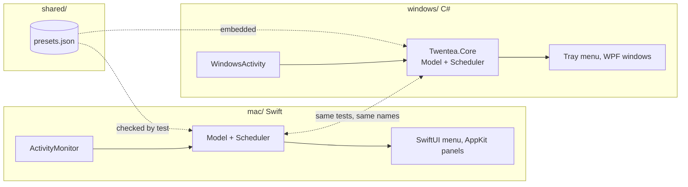
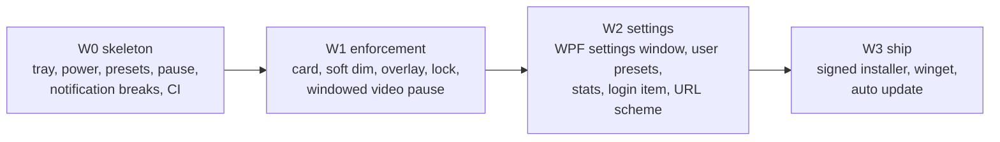
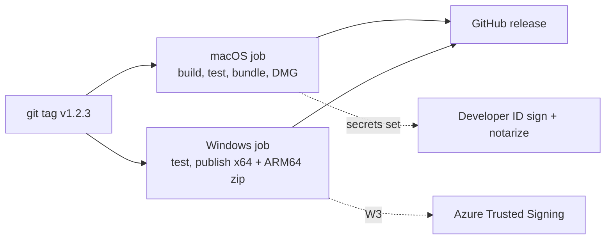

# Twentea for Windows

A native Windows tray app with the same presets, settings file and break rules as the Mac app.

## Stack

| Layer | Choice |
|---|---|
| Language | C# on .NET 10 (LTS) |
| Tray icon and menu | WinForms `NotifyIcon` |
| Break windows, settings | WPF (from W1) |
| Storage | `%APPDATA%\Twentea\settings.json`, same JSON as the Mac |
| Notifications | Balloon tips in W0, Windows App SDK toasts in W2 |
| Distribution | Zip in W0, signed installer and winget in W3 |
| Minimum OS | Windows 10 21H2, x64 and ARM64 |

## How the code splits

## Feature mapping

| Mac | Windows |
|---|---|
| Menu bar icon with countdown | Tray icon. Windows cannot show text next to it, so the countdown goes in the tooltip, and W2 draws the minutes into the icon |
| `CGEventSource` idle time | `GetLastInputInfo` |
| App switch notification | `SetWinEventHook(EVENT_SYSTEM_FOREGROUND)` |
| Camera and mic in use | `ConsentStore` registry keys, `LastUsedTimeStop = 0` |
| Video playing | `SHQueryUserNotificationState` for full screen (W0), media session playback state (W1) |
| `NSPanel` card, dim, overlay | Topmost, layered, `WS_EX_NOACTIVATE` WPF windows on every monitor |
| Hard lock | Same overlay with focus. Win+L and Ctrl+Alt+Del still work |
| IOPM sleep assertion | `SetThreadExecutionState(ES_SYSTEM_REQUIRED)` |
| `SMAppService` login item | `HKCU\...\Run` key |
| `twentea://` URL scheme | `HKCU\Software\Classes\twentea`, forwarded to the running instance over a named pipe |

## Phases

| Phase | Done when |
|---|---|
| W0 | Tray app runs, scheduler and store pass the shared tests, CI builds both platforms. **Done** |
| W1 | Every enforcement level renders on all monitors and `Supported()` in `TrayApp.cs` is deleted |
| W2 | Every row in `docs/PARITY.md` reads `done` on Windows |
| W3 | `winget install Twentea` works and updates arrive without a manual download |

## Release pipeline

Signing is optional. Without secrets, the Mac build is ad-hoc signed and the Windows build is
unsigned, so Gatekeeper and SmartScreen warn on first launch.
